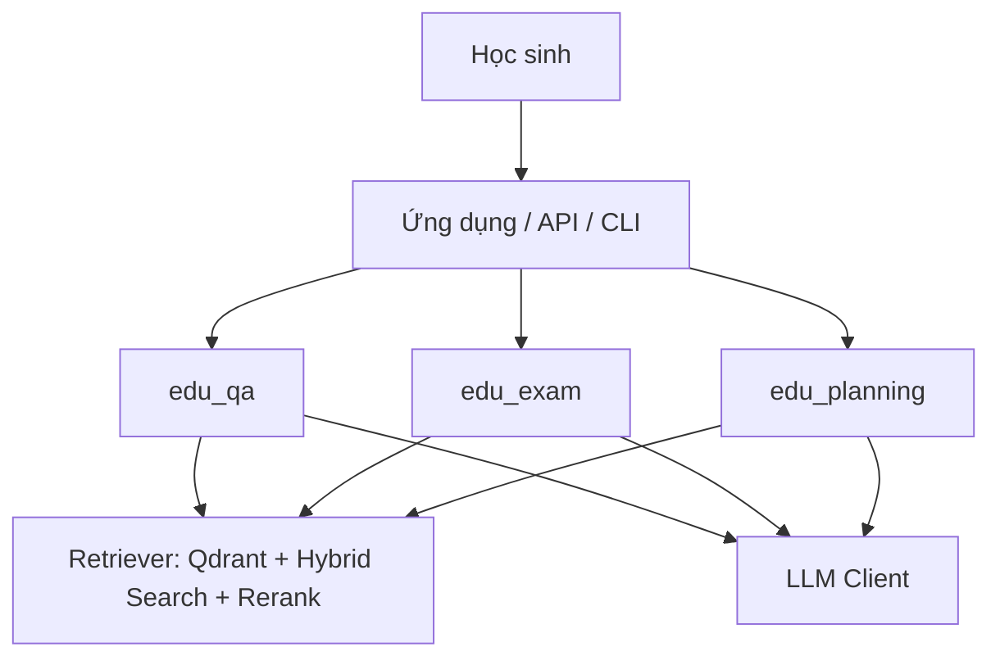
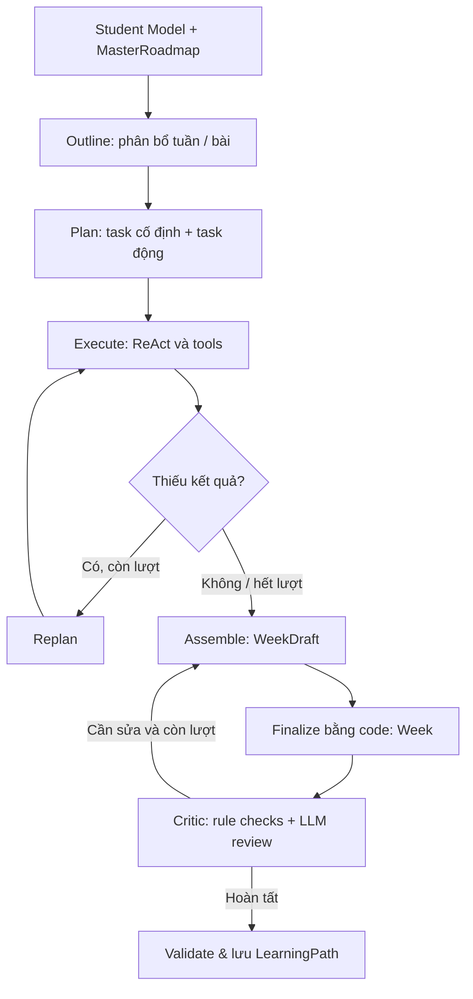

# EDUAGENT — Hệ thống hỗ trợ học tập cá nhân hóa bằng Multi-Agent AI

> Nền tảng nghiên cứu và phát triển trợ lý học tập cho học sinh lớp 10, kết hợp **LLM, Retrieval-Augmented Generation (RAG), LangGraph** và các công cụ xử lý chuyên biệt. Ba phân hệ chính: **Hỏi đáp kiến thức**, **Tạo đề kiểm tra** và **Xây dựng lộ trình học tập cá nhân hóa**.

[](https://www.python.org/)
[](https://github.com/langchain-ai/langgraph)
[](https://qdrant.tech/)
[](#trạng-thái-phát-triển)

## Mục lục

- [Tổng quan](#tổng-quan)
- [Các chức năng](#các-chức-năng)
- [Kiến trúc hệ thống](#kiến-trúc-hệ-thống)
- [Công nghệ sử dụng](#công-nghệ-sử-dụng)
- [Cấu trúc repository](#cấu-trúc-repository)
- [Cài đặt và cấu hình](#cài-đặt-và-cấu-hình)
- [Chạy ứng dụng](#chạy-ứng-dụng)
- [Chi tiết pipeline](#chi-tiết-pipeline)
- [Trạng thái phát triển](#trạng-thái-phát-triển)
- [Định hướng tiếp theo](#định-hướng-tiếp-theo)
- [Lưu ý](#lưu-ý)

## Tổng quan

EDUAGENT hướng tới việc cá nhân hóa hoạt động tự học theo **năng lực hiện tại, mục tiêu điểm số, thời gian biểu và sở thích học tập**. Thay vì một chatbot duy nhất thực hiện mọi việc, hệ thống phân chia trách nhiệm cho các agent/node chuyên biệt và điều phối bằng **LangGraph**.

**Phạm vi triển khai chính:** Toán 10, Ngữ văn 10 và Lịch sử 10; dữ liệu được tổ chức theo chương/bài và tài liệu chương trình phổ thông. Repository cũng chứa tài liệu, dữ liệu và các nhánh thử nghiệm khác; điều đó không đồng nghĩa mọi môn hoặc bộ sách đã được tích hợp đầy đủ trong pipeline chạy chính.

**Nguyên tắc thiết kế:** LLM dùng cho hiểu yêu cầu, chọn công cụ và sinh nội dung; code và công cụ chuyên dụng xử lý lịch, phép tính, kiểm tra schema, ràng buộc và đối chiếu tài nguyên.

## Các chức năng

| Phân hệ | Mục đích | Thành phần chính |
| --- | --- | --- |
| **Hỏi đáp (`edu_qa`)** | Phân loại và giải đáp câu hỏi kiến thức hoặc bài tập; tận dụng RAG và công cụ tính toán | Router → Knowledge/Solve → Response |
| **Tạo đề (`edu_exam`)** | Thu thập phạm vi đề, truy xuất tài liệu, xây hồ sơ kiến thức, ma trận, đặc tả và câu hỏi; kiểm tra đầu ra | Collect → Retrieve → Knowledge → Matrix → Specs → Generate → Evaluate |
| **Lộ trình (`edu_planning`)** | Thu thập hồ sơ người học, lập khung lộ trình, tạo kế hoạch học theo giai đoạn và kiểm tra chất lượng | Collect → Planning → Learning Path |

### Hỏi đáp thông minh

- **Router** nhận diện câu hỏi cần làm rõ, hỏi lý thuyết hay giải bài tập.
- Nhánh **Knowledge** khai thác tài liệu qua RAG và có cơ chế tìm nguồn bổ sung trong các trường hợp phù hợp.
- Nhánh **Solve** sử dụng công cụ xử lý toán học (ví dụ SymPy) thay vì phụ thuộc hoàn toàn vào phép tính do LLM tự sinh.
- **Response** tổng hợp thành câu trả lời cho học sinh.

### Sinh đề kiểm tra

- Xác định môn học, phạm vi chương/bài và các ràng buộc đề.
- Truy xuất ngữ liệu SGK để tạo hồ sơ kiến thức.
- Thiết lập ma trận đề và đặc tả câu hỏi theo mức độ nhận thức.
- Sinh câu hỏi, đáp án và chạy bước đánh giá đầu ra.

### Lộ trình học cá nhân hóa

- **Collect Student Model:** hội thoại thu thập hồ sơ, cho phép cập nhật từng nhóm thông tin.
- **Planning Agent:** ReAct + công cụ tìm SGK/Web/YouTube để tạo **MasterRoadmap** gồm các giai đoạn, chương/bài, mục tiêu và tiêu chí hoàn thành; hỗ trợ góp ý/phê duyệt.
- **Learning Path Agent:** triển khai chi tiết cho **giai đoạn đang học**, đồng thời giữ outline các giai đoạn còn lại.
- **Cơ chế chất lượng:** kiểm tra ràng buộc bằng code, kết hợp bước review dựa trên LLM trong phân hệ Learning Path.

## Kiến trúc hệ thống



### Luồng lộ trình chi tiết



**Một số chi tiết đã thể hiện trong code:**

- `lp_outline.py` phân bổ outline theo tuần/bài cho các giai đoạn thuộc phạm vi đang xét.
- `lp_plan.py` xây cửa sổ chi tiết **toàn bộ giai đoạn hiện tại**, không còn giới hạn cố định một tuần như bản thiết kế cũ. Planner gồm **F1/F2** và tối đa **3 task do LLM bổ sung**.
- `lp_execute.py` dùng `create_agent()` làm **ReAct Executor**, có quan hệ phụ thuộc giữa task và thực thi đồng thời tối đa 3 worker.
- `lp_tools.py` phân tích kiến thức chương, tính lịch và tỉ lệ độ khó; có cache phân tích chương dưới `data/cache/chapter_knowledge/`.
- `lp_execute.py` nạp kiến thức chương từ cache vào `lp_knowledge` trong state để các bước sau dùng dữ liệu có cấu trúc.
- `lp_assemble.py` sinh bản nháp tuần; `lp_finalize.py` ghép và điền các trường kiến thức theo chương/bài bằng code.
- `lp_critic.py` và `lp_review.py` thực hiện kiểm tra quy tắc cùng đánh giá bổ sung trước khi xuất kết quả.
- `learning_path_graph.py` xác thực schema `LearningPath`, lưu kết quả và cập nhật trạng thái; luồng có giới hạn vòng replan/revision.

**Phạm vi tích hợp:** Các graph trong `edu_planning` dùng **LangGraph state chung**. Giao tiếp chuẩn A2A giữa các phân hệ lớn là định hướng tích hợp, **không nên hiểu là đã hoàn thiện chỉ vì từng phân hệ đã có code**.

## Công nghệ sử dụng

| Nhóm | Công nghệ / vai trò |
| --- | --- |
| Ngôn ngữ | Python 3.11+ |
| Điều phối multi-agent | LangGraph, LangChain |
| LLM | `LLMClient`, hỗ trợ cấu hình OpenAI / Groq / OpenRouter |
| Vector database | Qdrant |
| Retrieval | Dense + BM25 sparse + hybrid search |
| Reranking | `sentence-transformers` `CrossEncoder`; model mặc định trong `retrievers2.py`: `cross-encoder/mmarco-mMiniLMv2-L12-H384-v1` |
| Công cụ toán học | SymPy và các công cụ toán chuyên biệt |
| Tra cứu mở rộng | Web search / YouTube trong các tác vụ được cấu hình |
| API / giao diện thử nghiệm | FastAPI, HTML, CSS, JavaScript |
| Schema & validation | Pydantic; kiểm tra rule bằng Python |

> `pyproject.toml` hiện khai báo Python >= 3.11 và `langchain-groq`, nhưng **chưa liệt kê đầy đủ mọi thư viện được import trong repository**. Vì vậy hướng dẫn môi trường bên dưới mang tính thiết lập phát triển; chưa phải bản cài đặt tái lập hoàn toàn tự động.

## Cấu trúc repository

```text
edu_agents/
├── main.py                         # Menu CLI; QA/Exam và placeholder Planning
├── pyproject.toml                  # Metadata / cấu hình Poetry
├── poetry.lock
├── README.md
├── prompt_edu/prompt/              # Prompt cho QA, Exam, Planning
├── prompts/                        # Prompt và thử nghiệm bổ sung
├── src/
│   ├── agents/                     # Agent/phiên bản thử nghiệm
│   ├── api/                        # FastAPI entrypoint và routers
│   ├── api_phuocmq/                # Biến thể giao diện/API
│   ├── UI/                         # Tài nguyên giao diện
│   ├── clients/                    # LLM, embeddings, database
│   ├── edu_qa/                     # Pipeline hỏi đáp
│   ├── edu_exam/                   # Pipeline sinh đề
│   ├── edu_planning/               # Pipeline tạo lộ trình
│   ├── modules/                    # RAG, tài liệu, xử lý dữ liệu
│   ├── eval_retriver/              # Script/dữ liệu đánh giá retrieval
│   ├── state_plan.py               # Schema và state lộ trình
│   ├── state_edu.py                # State sinh đề
│   └── configs.py                  # Biến môi trường
├── plans/                          # Một số kết quả kế hoạch thử nghiệm
└── bao_cao_slide/                  # Tài liệu / báo cáo dự án
```

### Những file đáng đọc đầu tiên

| Nhu cầu | File |
| --- | --- |
| Xem cách khởi chạy CLI | [`main.py`](main.py) |
| Xem graph hỏi đáp | [`src/edu_qa/graph.py`](src/edu_qa/graph.py) |
| Xem graph tạo đề mới | [`src/edu_exam/graph_exam_v2.py`](src/edu_exam/graph_exam_v2.py) |
| Xem graph lộ trình tổng | [`src/edu_planning/roadmap_graph.py`](src/edu_planning/roadmap_graph.py) |
| Xem Hybrid Plan-and-Execute + ReAct | [`src/edu_planning/learning_path_graph.py`](src/edu_planning/learning_path_graph.py) |
| Xem planner / executor | [`lp_plan.py`](src/edu_planning/lp_plan.py) · [`lp_execute.py`](src/edu_planning/lp_execute.py) |
| Xem retrieval / reranking | [`retrievers2.py`](src/modules/rag/process_toan_10/retrievers2.py) |
| Xem cấu hình | [`src/configs.py`](src/configs.py) |

## Cài đặt và cấu hình

### 1. Yêu cầu

- Python **3.11+**.
- Qdrant đang chạy hoặc Qdrant Cloud, có collection và embeddings tương thích với dữ liệu đã index.
- API key cho LLM provider đã chọn; các công cụ tìm kiếm mở rộng cần API key riêng khi sử dụng.
- Tài nguyên đủ để chạy embedding/reranker trên CPU hoặc GPU.

### 2. Clone và tạo môi trường

```bash
git clone https://github.com/MaiQuangPhuoc/edu_agents.git
cd edu_agents
python -m venv .venv
```

**Windows PowerShell:**

```powershell
.venv\Scripts\Activate.ps1
```

**Linux/macOS:**

```bash
source .venv/bin/activate
```

Có thể sử dụng Poetry để quản lý môi trường:

```bash
pip install poetry
poetry install
```

**Quan trọng:** Do `pyproject.toml` chưa khai báo đủ các dependency đang được sử dụng, `poetry install` hiện **không bảo đảm chạy được mọi phân hệ**. Cần đồng bộ dependency/lockfile trước khi triển khai hoặc đóng gói production.

### 3. Thiết lập biến môi trường

`src/configs.py` khai báo cấu hình qua `pydantic-settings`. Các biến cốt lõi:

```dotenv
# Provider: openai | groq | openrouter
API_PROVIDER=groq
MODEL=<ten-model-co-quyen-truy-cap>
GROQ_API_KEY=<your-groq-api-key>

# Chỉ cần khi dùng provider tương ứng
OPENAI_API_KEY=
OPENROUTER_API_KEY=

QDRANT_URL=<your-qdrant-url>
QDRANT_API_KEY=<your-qdrant-api-key>
EMBEDDING_MODEL=<embedding-model-name>

# Nếu sử dụng web search
API_KEY_TAVILY=
```

Lưu cấu hình tại `src/.env` **hoặc** cung cấp qua biến môi trường hệ thống. Lưu ý phiên bản `src/configs.py` trong repo hiện còn `env_file` trỏ đến **đường dẫn Windows tuyệt đối trên máy tác giả**; khi chạy ở máy khác, cần sửa thành đường dẫn phù hợp. Không commit API key hay file `.env` chứa bí mật.

Ngoài API key, dự án cần collection Qdrant phù hợp; các entrypoint có thể tham chiếu tên collection khác nhau (`documents` và `doc_final`). Hãy kiểm tra lại trước khi chạy.

## Chạy ứng dụng

### CLI chính

```bash
python main.py
```

CLI hiển thị lựa chọn:

1. Hỏi đáp.
2. Tạo bài kiểm tra.
3. Tạo lộ trình học.

**Trạng thái thực tế:** Trong `main.py`, mục **3** đang là thông báo "chức năng lộ trình học đang phát triển". Logic Learning Path đã tồn tại trong `src/edu_planning`, nhưng **chưa được nối vào menu này**.

### Chạy thử phân hệ lộ trình

```bash
python -m src.edu_planning.run_planning
```

Trong [`run_planning.py`](src/edu_planning/run_planning.py), biến `MODE` mặc định là `"collect"` để thử phần thu thập hồ sơ **không cần retriever**. Đặt `MODE = "full"` nếu muốn thử graph đầy đủ (cần cấu hình LLM, Qdrant và môi trường hoạt động). Code chạy thử dùng `MemorySaver` để duy trì state theo `thread_id`.

### API / giao diện

Để chạy giao diện chat thử nghiệm bằng FastAPI, cấu hình API key và Qdrant trong `src/.env`, cài dependencies của môi trường, rồi chạy từ thư mục gốc repository:

```powershell
poetry install
poetry run uvicorn src.api.main:app --reload --port 8000
```

Mở [http://127.0.0.1:8000](http://127.0.0.1:8000). Chat hỏi đáp kết nối tới graph `edu_qa`; API cũng giữ các router thử nghiệm cho tạo đề. Trạng thái phiên chat được lưu trong bộ nhớ của tiến trình, nên sẽ mất khi khởi động lại server. Các lệnh trên dành cho phát triển/thử nghiệm, không phải cấu hình production.

## Chi tiết pipeline

### 1. QA: Router → Knowledge / Solve → Response

**Mã nguồn:** `src/edu_qa/graph.py`. Graph phân luồng theo loại yêu cầu; nhánh cần hỏi rõ có thể kết thúc sớm. Nhánh lý thuyết đi qua Knowledge Agent; bài tập đi qua Solve Agent; cuối cùng được tổng hợp bởi Response Agent.

### 2. Exam: Collect → Retrieve → Knowledge → Matrix → Specs → Generate → Evaluate

**Mã nguồn:** `src/edu_exam/graph_exam_v2.py`. Đây là graph sinh đề phiên bản v2 được dùng trong API; mỗi bước có đầu ra/state riêng. Khi bước đánh giá chưa đạt điều kiện kết thúc, graph có thể quay lại bước sinh câu hỏi theo logic hiện tại.

### 3. Planning: Collect → MasterRoadmap → LearningPath

**Mã nguồn:** `src/edu_planning/roadmap_graph.py` và `src/edu_planning/learning_path_graph.py`.

- **Collect:** tạo/cập nhật `StudentModel`, lưu hồ sơ và chuẩn bị truy vấn tra cứu.
- **Master Planning:** ReAct tìm kiếm thông tin, LLM xuất `MasterRoadmap` có cấu trúc; có vòng phản hồi từ học sinh.
- **Outline:** tạo phân bổ tuần ở mức khái quát trên phần giai đoạn được xét.
- **Detailed Learning Path:** xác định task, dùng ReAct với tools để thu thập dữ liệu, sinh nháp từng tuần và hoàn thiện bằng code.
- **Validation & persistence:** kiểm tra bài học, số buổi, kết quả đánh giá; lưu `LearningPath` theo học sinh.

### 4. Retrieval và tối ưu

`VectorStoreRetriever` tại `src/modules/rag/process_toan_10/retrievers2.py` hỗ trợ dense, sparse (BM25), hybrid search, rerank và `rerank_batch()`; ColBERT prefilter là tùy chọn. Model mặc định hiện tại là **mMiniLMv2 đa ngôn ngữ** (xem tên model đầy đủ ở bảng công nghệ).

Trong Learning Path, kết quả phân tích kiến thức chương được cache theo **môn + chương** để giảm phân tích lặp lại. Cache này khác với cache kết quả truy vấn Qdrant hay điểm rerank theo query-document.

## Trạng thái phát triển

| Hạng mục | Hiện trạng đọc từ repository |
| --- | --- |
| QA LangGraph | Đã có graph, agent, state, tools và lệnh chạy thử |
| Exam v2 LangGraph | Đã có graph 7 bước và đánh giá đầu ra; cần kiểm thử end-to-end trong môi trường đích |
| Planning / Learning Path | Đã có graph tổng, outline, Plan-and-Execute + ReAct, assemble/finalize và critic; chưa nối vào CLI chính |
| Lưu hồ sơ / lộ trình | Đã có file store; cần kiểm tra tính di động của đường dẫn trên các máy |
| Adaptive progress tracking | Định hướng phát triển; không mô tả là đã triển khai trọn vẹn |
| A2A giữa ba phân hệ | Chưa có bằng chứng đủ để khẳng định tích hợp A2A chuẩn hoạt động end-to-end |
| Cài đặt/deploy | Dependency chưa đồng bộ hoàn chỉnh, cấu hình cần chỉnh theo môi trường |

## Định hướng tiếp theo

1. **Ổn định môi trường:** chuẩn hóa dependency trong `pyproject.toml`, `.env.example`, đường dẫn và cấu hình Qdrant; bổ sung kiểm thử khởi động.
2. **Hoàn thiện tích hợp:** nối Learning Path vào giao diện/API, chuẩn hóa lưu và tải state/file theo `student_id`.
3. **Đánh giá chất lượng:** bộ kiểm thử QA/Exam/Planning, đặc biệt về độ chính xác tài liệu, schema, logic phân bổ thời gian và giới hạn replan.
4. **Adaptive learning:** thu thập kết quả làm bài, tương tác hỏi đáp, cập nhật năng lực và điều chỉnh các buổi học tương lai.
5. **Tích hợp giữa phân hệ:** chuẩn hóa hợp đồng dữ liệu và nghiên cứu A2A cho tái sử dụng QA/Exam khi học theo lộ trình.
6. **Hiệu năng:** đo tách biệt thời gian khởi tạo model, retrieval, rerank và gọi LLM; tiếp tục tối ưu cache và batching.

## Lưu ý

- Đây là **repository nghiên cứu / đang phát triển**; cấu trúc chứa cả code hiện hành, phiên bản cũ và tài liệu thử nghiệm.
- README mô tả **những gì thể hiện trong code**, không phải cam kết các luồng đã được kiểm thử thành công trên mọi môi trường.
- Không đặt API key thật, dữ liệu học sinh nhạy cảm hay file `.env` trong commit công khai.
- Khi sử dụng tài liệu bên ngoài, cần kiểm tra nguồn, quyền sử dụng và độ phù hợp với học sinh.

---

**Repository:** [MaiQuangPhuoc/edu_agents](https://github.com/MaiQuangPhuoc/edu_agents)  
**Mục tiêu:** phát triển hệ thống hỗ trợ học tập đa tác nhân, có khả năng truy xuất kiến thức và cá nhân hóa lộ trình theo người học.
