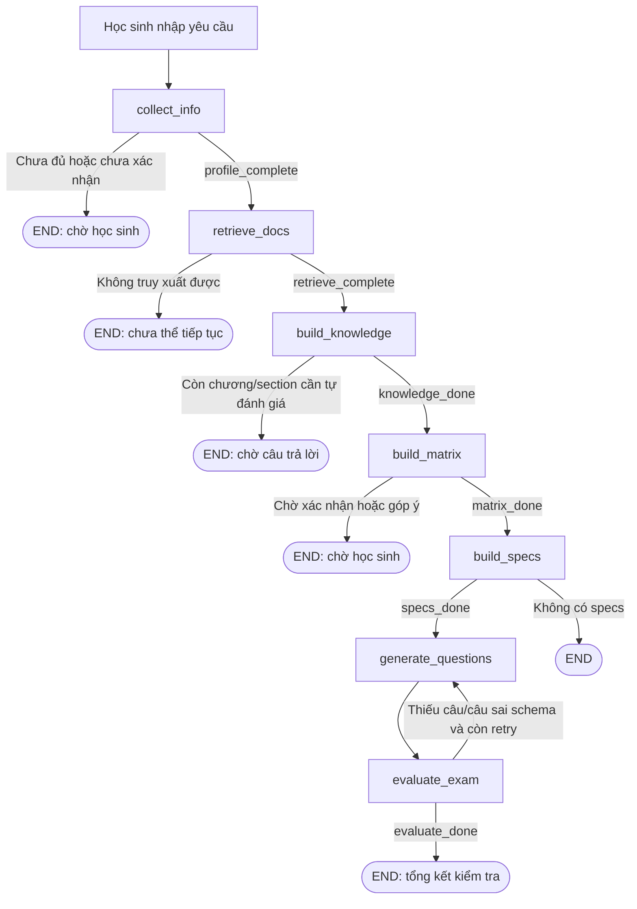

# EDUAGENT — Edu Exam: Kiến trúc và luồng tạo đề kiểm tra

> Tài liệu kỹ thuật dựa trên mã nguồn `MaiQuangPhuoc/edu_agents`, nhánh `main`, đọc ngày 18/10/2026. Tập trung **pipeline V2** (`graph_exam_v2.py`, các node `*_v2.py`, `state_edu.py`). Đây là mô tả hành vi theo code, **không phải cam kết đã kiểm thử end-to-end**.

## 1. Mục tiêu và phạm vi

`edu_exam` là phân hệ tạo đề kiểm tra tùy chỉnh từ yêu cầu người học, chương trình học (curriculum) và tài liệu truy xuất từ RAG. Hệ thống hỏi yêu cầu, xác định nội dung kiểm tra, hỏi mức độ quan tâm/tự đánh giá theo các mục kiến thức, xây dựng ma trận và đặc tả câu hỏi, tạo đề trắc nghiệm, rồi kiểm tra câu hỏi — đặc biệt với bài tập tính toán.

Mã nguồn bao gồm cả bản V1 và V2. **Luồng được mô tả ở đây là V2**, sử dụng `src/edu_exam/graph_exam_v2.py`. Không nên đồng nhất V1 với V2 hay cho rằng mọi tính năng cũ đều còn được gọi trong V2.

## 2. Sơ đồ tổng thể



**Lưu ý về các lượt chat:** `graph.invoke(state)` chạy đến `END`. Những nút cần học sinh tương tác sẽ trả state và một tin nhắn, sau đó lần nhập tiếp theo đưa `HumanMessage` vào state và gọi graph **lại từ `collect_info`**; các node đã hoàn thành sẽ bỏ qua nhờ cờ trạng thái của chúng.

| # | Node | File | Điều kiện chuyển tiếp |
|---|---|---|---|
| 1 | `collect_info` | `collect_info_v2.py` | `profile_complete` |
| 2 | `retrieve_docs` | `retrieve_docs_v2.py` | `retrieve_complete` |
| 3 | `build_knowledge` | `build_knowledge_v2.py` | `knowledge_done` |
| 4 | `build_matrix` | `build_matrix_v2.py` | `matrix_done` |
| 5 | `build_specs` | `build_specs_v2.py` | `specs_done` |
| 6 | `generate_questions` | `generate_questions_v2.py` | Luôn sang `evaluate_exam` |
| 7 | `evaluate_exam` | `evaluate_exam_v2.py` | `evaluate_done` hoặc quay lại Generate |

## 3. Các node, theo thứ tự thực thi

### 3.1. `collect_info` — Thu thập yêu cầu tạo đề

**Đầu vào:** `messages`, `student_profile`, `profile_complete`.

- Prompt: `prompt_edu/prompt/collect_info_v2.txt` (đường dẫn được ánh xạ qua `src/edu_qa/paths.py`).
- LLM với structured output `CollectInfoResponse`: `reply`, `profile`, `is_confirmed`; trường `profile` dùng `StudentProfileSchema` trong `src/state_edu.py`.
- Trường bắt buộc được **code kiểm tra**: `mon_hoc`, `khoi_lop`, `pham_vi_kiem_tra`. Các trường tùy chọn gồm mục đích, loại đề, số câu, thời gian làm bài, điểm mục tiêu, tự đánh giá và ghi chú.
- `_merge_profile` chỉ ghi đè các trường LLM trả giá trị khác `None`, giúp giữ thông tin trước đó.
- `_recent_history` lấy tối đa **5 lượt tin người học gần nhất và những tin xen giữa**; đồng thời đưa bản tóm tắt trường đã biết vào system prompt. Đây là rút gọn **theo lượt**, không phải tóm tắt ngữ nghĩa.
- Gọi structured LLM, thử lại tối đa 3 lần khi lỗi; nếu thất bại trả lời yêu cầu học sinh nhắc lại.
- Chỉ đặt `profile_complete=True` khi **đủ ba trường bắt buộc và `is_confirmed=True`**.

**Đầu ra:** cập nhật `student_profile`, thêm `AIMessage`, `current_step='collect_info'`.

### 3.2. `retrieve_docs` — Ánh xạ chương trình và truy xuất tài liệu

**Đầu vào:** `student_profile`; retriever đã được khởi tạo bên ngoài.

1. `curriculum.map_scope(profile)` dùng `pham_vi_kiem_tra` và `mon_hoc` để ánh xạ phạm vi thành `scope_chapters` và `scope_lessons` theo cấu trúc `curriculum_sections.json`.
2. Với mỗi chương, tạo query từ **tên chương + danh sách bài**.
3. Cascade retrieval, tối đa hai vòng:
   - **Round 1:** hybrid fetch `k=10`, rerank lấy top 3, lọc score từ `0.6`.
   - **Round 2:** nếu Round 1 còn dưới 3 kết quả, fetch `k=15`, rerank top 5, lọc score từ `0.6`.
4. Lọc `chapter_id` trước rerank và tránh lặp `chunk_id` đã thu thập từ các chương trước.
5. Chuyển các document thành `{'content', 'metadata'}`.

**Đầu ra:** `retrieved_chunks`, `scope_chapters`, `scope_lessons`, `retrieve_complete = len(chunks) > 0`.

**Điểm cần lưu ý:** Round 2 **thay thế** kết quả Round 1 cho chương đang xử lý, không hợp nhất hai vòng. Mã hiện tại chỉ lọc `chapter_id` sau retrieval. Nếu không ánh xạ được chương hoặc không có chunk, graph dừng ở lượt đó.

### 3.3. `build_knowledge` — Tự đánh giá và tạo hồ sơ tri thức

Bước này có **hai pha**:

**Pha A — Thu thập điểm quan tâm/tự đánh giá theo section**

- Xác định hàng đợi chương bằng `extract_chapter_ids()`.
- Với từng chương, lấy các bài và section từ curriculum, gửi câu hỏi để học sinh nhập mức `0–3` theo thứ tự.
- Code dùng regex `r'[0-3]'` để tách số và gán về `knowledge_scores[ch_id][lesson][section]`.
- Nếu có section thiếu điểm sau khi hỏi hết chương, hỏi bổ sung **một lượt**; section vẫn thiếu sau đó được mặc định bằng `1`.
- Dữ liệu được điều phối bởi `knowledge_queue`, `knowledge_pending`, `knowledge_scores`, `knowledge_retried`.

**Pha B — LLM phân tích kiến thức theo chương**

- Dùng điểm section, cấu trúc SGK và tối đa 10 chunk của mỗi chương.
- Prompt `analyze_knowledge_v2.txt`, schema `KnowledgeChapterProfile`.
- Nội dung gồm kiến thức cần nắm/cần hiểu, quan hệ kiến thức, quan hệ dạng bài, danh sách dạng bài gắn section.
- Mỗi chương thử gọi structured LLM tối đa 3 lần.
- Code **ghi đè tên chương và danh sách bài** từ curriculum, lọc dạng bài có `section` không hợp lệ.
- Nếu phân tích chương thất bại, lưu profile rỗng tương ứng và ghi danh sách `knowledge_analysis_failed`.

**Đầu ra:** `knowledge_scores`, `knowledge_profile`, `knowledge_done=True`, `completed_build_knowlege`.

**Cảnh báo:** Dùng `re.findall('[0-3]', last_input)` không xác thực chặt định dạng số; ví dụ văn bản có các chữ số ngoài ý muốn vẫn có thể ảnh hưởng việc gán. Giá trị mặc định `1` là quy tắc của code, không phải điểm thực tế do học sinh cung cấp.

### 3.4. `build_matrix` — Xây dựng và xin duyệt ma trận đề

**Đầu vào:** `student_profile`, `knowledge_scores`, `knowledge_profile`, `gop_y_matrix`, `exam_matrix`.

- Nếu chưa có `exam_matrix`, code tính **phân bổ đề xuất số câu theo chương**, trọng số là tổng điểm section của chương.
- Bảng `DIFFICULTY_RATIO` xác định tỷ trọng dễ/trung bình/khó dựa trên `muc_tieu_diem` từ 5–10 (ví dụ điểm mục tiêu 9: `20% / 30% / 50%`).
- `_total_difficulty` làm tròn tổng độ khó sao cho tổng số câu đúng số lượng dự kiến.
- Prompt `build_matrix_v2.txt`; structured output `ExamMatrixResponse` gồm chương, bài, dạng bài, số câu và độ khó.
- `check_matrix` kiểm tra tổng câu, đủ chương, tổng độ khó (sai số cho phép ±1), tổng phân chia theo bài và dạng bài; thử chỉnh tối đa 3 lần khi lỗi.
- Trả ma trận JSON vào chat và hỏi học sinh có góp ý không; nếu phản hồi là `ok`, `xong`, `đồng ý`, `không` hoặc chuỗi rỗng thì chốt; phản hồi khác trở thành `gop_y` để LLM xây lại.

**Đầu ra:** `exam_matrix`, `matrix_done`, `messages`.

**Hạn chế hiện tại:** Nếu hết 3 lượt nhưng kết quả cuối vẫn còn lỗi kiểm tra, code vẫn có thể dùng kết quả cuối thay vì dừng cứng. Nhánh xác nhận đang so khớp danh sách từ khóa cụ thể; câu “xác nhận” được gợi ý trong tin Bot nhưng **không nằm trong danh sách từ khóa duyệt nhanh**, nên có thể bị hiểu là góp ý để sinh lại ma trận.

### 3.5. `build_specs` — Lập đặc tả/khung câu hỏi

**Đầu vào:** ma trận đề, hồ sơ tri thức, chunk tài liệu.

1. Code tạo các **frame** cho từng câu theo phân bố chương/bài/dạng bài/độ khó từ ma trận, tự gán ID liên tục.
2. Phân loại `ly_thuyet` hoặc `bai_tap` theo tỷ lệ xác định bằng code từ hồ sơ.
3. Gom frame thành batch **5 câu**.
4. Prompt `build_specs_v2.txt`; LLM structured output `SpecContentBatch` để viết `yeu_cau`, `muc_dich`, `ngu_canh` dựa vào `knowledge_profile` và chunk.
5. Kiểm tra ID trả về đúng batch, thử tối đa 3 lần; nếu vẫn lỗi, giữ frame và dùng nội dung dự phòng cho các trường do LLM bổ sung.

**Đầu ra:** `question_specs` (danh sách dictionary), `specs_done = len(all_specs) > 0`.

**Phân công:** Code quyết định ID/bài/dạng bài/độ khó/loại câu; LLM chỉ bổ sung diễn giải và ngữ cảnh.

### 3.6. `generate_questions` — Sinh câu hỏi và lưu đề JSON

**Đầu vào:** `question_specs`, `retrieved_chunks`, `exam_memory`, `generated_exam`, `regenerate_ids`.

- Phân nhóm theo chương, batch **5 câu**; chọn chunk theo tên **bài học**, fallback về chunk chương nếu không khớp bài.
- Ghép prompt `generate_questions_v2.txt` với đặc tả, tài liệu và `exam_memory` để giảm trùng ý tưởng.
- Structured output `GeneratedQuestionBatch`, mỗi câu gồm ID, `type`, độ khó, nội dung, 4 lựa chọn A–D, đáp án, giải thích và ý tưởng.
- Thử tối đa 3 lần mỗi batch nếu thiếu câu/parse lỗi; giữ batch có số câu nhận được tốt nhất, không bảo đảm luôn đủ số câu.
- Code lấy `type`, chương, bài, dạng bài theo **spec** thay vì tin hoàn toàn giá trị LLM.
- Kiểm tra sơ bộ lựa chọn trùng nội dung; ghi `validation.hard_check`.
- Cập nhật `exam_memory` (ID, chương, bài, dạng bài, ý tưởng).
- Ghi tệp `exam_YYYYMMDD_HHMMSS.json` vào `TEST_EXAM_PROMPT_PATH`; trả `exam_id` là tên file không có đuôi.
- Khi có `regenerate_ids`, chỉ sinh bù các spec mang ID được yêu cầu, giữ các câu đã được đánh giá là đạt.

**Đầu ra:** `generated_exam`, `exam_memory`, `exam_id`, `generate_done=True`.

### 3.7. `evaluate_exam` — Kiểm tra cấu trúc, số lượng và đáp án bài tập

**Pha 1: Kiểm tra bằng code**

- `_check_schema(q)` kiểm tra các trường bắt buộc của câu hỏi.
- `_check_counts(state)` kiểm tra số câu và ID có trong `question_specs`.
- Nếu có `invalid_ids` hoặc `missing_spec_ids` và chưa hết `MAX_RETRY=2`, bỏ các câu lỗi, gán `regenerate_ids`, đặt `generate_done=False`, quay lại `generate_questions`.
- Hết số lần thử mà vẫn còn lỗi thì **vẫn tiếp tục kiểm tra**, không mặc định thất bại toàn pipeline.

**Pha 2: Đối chiếu câu `bai_tap` bằng code**

- Chỉ áp dụng cho câu `type='bai_tap'`.
- Gom batch 4 câu (`CODE_VERIFY_BATCH_SIZE=4`), yêu cầu LLM tạo mã lời giải phù hợp với công cụ tính toán/SymPy, chạy mã qua hàm `run_sympy_code`.
- Nếu chưa lấy được đáp án: thử sửa code tối đa 2 lần (`MAX_FIX_RETRY=2`).
- Nếu đáp án code và đáp án câu hỏi lệch nhau: tối đa 3 vòng giải lại theo hướng khác (`MAX_MISMATCH_RETRY=3`).
- Dùng bỏ phiếu theo kết quả các lần chạy; gán `check`: `✅`, `⚠️ nghi ngờ đề sai`, `N/A` hoặc `N/A (không đồng thuận)`.
- Ghi `answer_code`, `check` trở lại tệp JSON đề thi bằng `_update_exam_json_with_tool_check()`.

**Pha 3: Thông báo**

- Trả AIMessage tổng kết số câu đạt schema, số câu đủ/thiếu, số bài tập đối chiếu khớp/nghi ngờ/không kết luận.
- Đặt `evaluate_done=True`. Đây là **hoàn tất quy trình đánh giá**, không đồng nghĩa 100% câu đều được xác minh đúng.
- `final_exam` có trong schema/state khởi tạo, nhưng **hàm `evaluate_exam_v2.py` hiện không trả `final_exam`**; giao diện/API dựa vào field này cần được kiểm tra thêm.

## 4. State: dữ liệu truyền giữa các bước

`src/state_edu.py` khai báo `ExamState` là `TypedDict`; `messages` dùng `Annotated[list, add_messages]` để nối lịch sử trong LangGraph.

| Nhóm | Trường tiêu biểu | Ý nghĩa |
|---|---|---|
| Hội thoại/thu thập | `messages`, `student_profile`, `profile_complete` | Yêu cầu ra đề và xác nhận |
| Retrieval | `retrieved_chunks`, `scope_chapters`, `scope_lessons`, `retrieve_complete` | Nguồn học liệu theo curriculum |
| Knowledge | `knowledge_queue`, `knowledge_pending`, `knowledge_scores`, `knowledge_profile`, `knowledge_done` | Tự đánh giá và phân tích tri thức |
| Matrix | `exam_matrix`, `gop_y_matrix`, `matrix_done` | Phân phối số câu và sự đồng ý của học sinh |
| Specs | `question_specs`, `specs_done` | Mỗi ID ứng với đặc tả câu hỏi |
| Generate | `generated_exam`, `exam_memory`, `generate_done`, `exam_id` | Đề, bộ nhớ ý tưởng và file lưu |
| Evaluate | `exam_review`, `final_exam`, `evaluate_done` | Kết quả đánh giá dự kiến |
| Meta | `current_step`, `error` | Theo dõi tiến trình |

**Lệch giữa định nghĩa và runtime:** `run_exam_v2.build_initial_state()` có thêm `knowledge_retried`, `regenerate_ids`, `evaluate_retry_count`, trong khi `ExamState` chưa khai báo đầy đủ các key này. Một vài key khác như `knowledge_analysis_failed` và `count_check` được node tạo động. Cần đồng bộ schema khi củng cố hệ thống.

## 5. Prompts và schema liên quan

| Bước | Prompt | Schema structured output |
|---|---|---|
| Collect | `collect_info_v2.txt` | `CollectInfoResponse`, `StudentProfileSchema` |
| Retrieval | Không có prompt sinh trực tiếp ở V2 | Logic code + Qdrant/Reranker |
| Knowledge: câu hỏi tự đánh giá | `build_knowledge_v2.txt` | Câu hỏi được format từ template |
| Knowledge: phân tích | `analyze_knowledge_v2.txt` | `KnowledgeChapterProfile` |
| Matrix | `build_matrix_v2.txt` | `ExamMatrixResponse` |
| Specs | `build_specs_v2.txt` | `SpecContentBatch` |
| Generate | `generate_questions_v2.txt` | `GeneratedQuestionBatch` |
| Evaluate | Prompt dựng trong `evaluate_exam_v2.py` | `CodeSolutionBatch` (định nghĩa tại module) |

Các đường dẫn prompt được cấu hình qua `src/edu_qa/paths.py`. Các định nghĩa schema chính nằm trong `src/state_edu.py`.

## 6. Cách chạy

### Điều kiện tiên quyết

- Python theo cấu hình repo (hiện `pyproject.toml` ghi `>=3.11`).
- Cấu hình nhà cung cấp LLM / API key, Qdrant và model embedding/reranker hợp lệ.
- Collection Qdrant chứa tài liệu đã index, metadata tương thích: `subject`, `chapter_id`, `chunk_id`, `lesson` (phần dùng tới tùy node).
- Tệp curriculum tại `src/modules/documents/curriculum_sections.json` tồn tại và đọc được.

### Chạy V2 từ thư mục gốc repo

```bash
python -m src.edu_exam.run_exam_v2
```

CLI khởi tạo `LLMClient`, `embeddings_qa`, `VectorStoreRetriever` (`collection_name='doc_final'`, `tools_collection_name='tools'`), gọi `create_graph(...)`, khởi tạo state bằng `build_initial_state()`, rồi đưa tin nhắn học sinh vào `state['messages']` trước khi gọi `graph.invoke(state)`.

Nhập `q` để thoát. Các bước yêu cầu thêm phản hồi sẽ trả lời và chờ lượt nhập tiếp theo.

**Chú ý quan trọng về đường dẫn:** `curriculum.py` và `src/edu_qa/paths.py` (biến `TEST_EXAM_PROMPT_PATH`) vẫn chứa đường dẫn Windows tuyệt đối trên máy phát triển. Muốn chạy ở máy khác cần sửa thành đường dẫn dựa trên `Path(__file__)` / project root. Tệp lưu đề có thể bị ghi ở thư mục khác dự kiến nếu chưa sửa.

## 7. Ví dụ hành trình người học

Đây là ví dụ minh họa **cách tương tác mong đợi**, không phải log chạy thành công đã được xác thực.

1. Học sinh: “Mình muốn đề Toán 10 kiểm tra chương I và II, 20 câu, mục tiêu 8 điểm.”
2. Collect hỏi thêm các trường còn thiếu (ví dụ khối lớp), tóm tắt yêu cầu, học sinh xác nhận.
3. Retrieval ánh xạ chương I–II từ curriculum và tìm chunk tài liệu theo chương.
4. Knowledge lần lượt hiển thị section của chương I và II, yêu cầu tự đánh giá 0–3.
5. LLM phân tích hồ sơ kiến thức, sau đó Matrix đề xuất phân bố 20 câu dễ/trung bình/khó; học sinh đồng ý hoặc góp ý.
6. Specs dựng 20 frame; Generate sinh câu hỏi theo batch 5, lưu file JSON.
7. Evaluate kiểm tra ID/schema, sinh bù câu lỗi (tối đa 2 vòng), xác minh câu bài tập bằng code và trả báo cáo.

## 8. Những điểm cần kiểm tra/sửa trước khi coi là hoàn thiện

| Ưu tiên | Quan sát từ code | Hướng xử lý đề xuất |
|---|---|---|
| Cao | `build_matrix_v2` gợi ý nhập “xác nhận” nhưng không coi đó là câu chốt nhanh | Bổ sung từ khóa hoặc router xác nhận rõ ràng |
| Cao | `final_exam` không được cập nhật ở cuối `evaluate_exam_v2` | Xác định nguồn đề cuối cùng và trả `final_exam` khi cần render UI |
| Cao | `_update_exam_json_with_tool_check()` chọn file `exam_*.json` mới nhất theo thư mục, không dùng `exam_id` hiện tại | Ghi đúng file của phiên đề, tránh ghi đè nhầm giữa nhiều session |
| Cao | `curriculum.py` và `TEST_EXAM_PROMPT_PATH` dùng đường dẫn Windows tuyệt đối | Chuyển sang project-relative paths |
| Cao | Chạy code LLM sinh ra để đối chiếu bài tập có rủi ro an toàn khi chưa sandbox cô lập đáng tin cậy | Chạy process cô lập, hạn mức tài nguyên, giới hạn quyền và áp dụng sandbox nghiêm ngặt |
| Trung bình | `ExamState` thiếu khai báo vài cờ đang dùng ở runtime | Đồng bộ TypedDict, state khởi tạo và node |
| Trung bình | Ma trận sai có thể vẫn được dùng sau khi hết retry | Fail/flag rõ thay vì âm thầm tiếp tục |
| Trung bình | Sinh câu thiếu hoặc kiểm tra thiếu vẫn có thể đặt `evaluate_done=True` | Phân biệt `completed_with_warnings` và `validated` |
| Trung bình | Score của reranker phụ thuộc model nhưng dùng ngưỡng cố định `0.6` | Benchmark phân phối điểm với model đang chạy |
| Trung bình | `_parse_scores_chapter` dùng regex tìm từng chữ số `0–3` | Parse đúng số lượng section và validate range/input |
| Trung bình | Logic phân phối câu theo tổng score dồn trọng số sang chương học sinh đánh giá cao | Xác định score biểu thị mức ưu tiên hay năng lực rồi chỉnh trọng số phù hợp |
| Trung bình | `so_cau_hoi` và `muc_tieu_diem` là optional nên có thể là `None` dù node dùng giá trị mặc định ở `.get()` | Chuẩn hóa số câu/điểm mục tiêu trước Matrix |

## 9. Tài liệu mã nguồn chính

- [Graph V2](https://github.com/MaiQuangPhuoc/edu_agents/blob/main/src/edu_exam/graph_exam_v2.py)
- [CLI V2](https://github.com/MaiQuangPhuoc/edu_agents/blob/main/src/edu_exam/run_exam_v2.py)
- [ExamState và Pydantic schemas](https://github.com/MaiQuangPhuoc/edu_agents/blob/main/src/state_edu.py)
- [Curriculum mapping](https://github.com/MaiQuangPhuoc/edu_agents/blob/main/src/edu_exam/curriculum.py)
- [7 node edu_exam V2](https://github.com/MaiQuangPhuoc/edu_agents/tree/main/src/edu_exam)
- [Prompt templates](https://github.com/MaiQuangPhuoc/edu_agents/tree/main/prompt_edu/prompt)

---

**Tóm tắt kiến trúc:** `Collect → Retrieve → Self-assessment/Knowledge → Matrix (+feedback) → Specs → Generate → Evaluate (+regenerate)`. Code quyết định điều phối, mapping, quota và nhiều bước kiểm tra; LLM đảm nhiệm trích xuất, phân tích và sinh nội dung. Kết quả đánh giá cần đọc cùng trạng thái warning, không nên suy diễn `evaluate_done=True` thành “đề chắc chắn đúng”.
