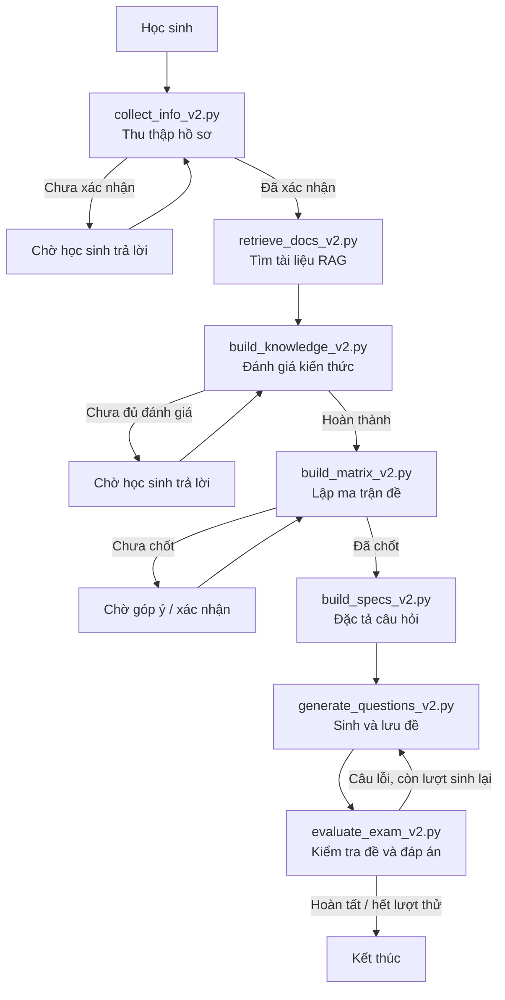

# EDU Exam — Luồng tạo đề kiểm tra

Module `src/edu_exam/` sử dụng **LangGraph** để tạo đề kiểm tra cá nhân hóa. Luồng chính hiện tại là **V2** (`graph_exam_v2.py`).

## Luồng xử lý

1. **`collect_info_v2.py`**: Trò chuyện để lấy môn học, lớp, phạm vi kiểm tra và các tùy chọn; chờ học sinh xác nhận.
2. **`retrieve_docs_v2.py`**: Xác định chương/bài từ `curriculum.py`, tìm tài liệu bằng RAG, lọc và rerank kết quả.
3. **`build_knowledge_v2.py`**: Hỏi học sinh tự đánh giá kiến thức từng chương/mục (0–3), sau đó dùng LLM phân tích nội dung cần kiểm tra.
4. **`build_matrix_v2.py`**: Phân bổ số câu theo chương, bài, dạng bài và độ khó; cho học sinh góp ý/xác nhận ma trận.
5. **`build_specs_v2.py`**: Tạo đặc tả từng câu hỏi dựa trên ma trận, hồ sơ kiến thức và tài liệu.
6. **`generate_questions_v2.py`**: Sinh câu hỏi trắc nghiệm theo từng nhóm 5 câu, lưu đề JSON; hỗ trợ sinh lại các câu lỗi.
7. **`evaluate_exam_v2.py`**: Kiểm tra cấu trúc, số lượng, câu thiếu; sinh lại khi cần (tối đa 2 lượt), dùng code/SymPy đối chiếu đáp án bài tập.

## Các file liên quan

- **`graph_exam_v2.py`**: Kết nối 7 node và điều kiện chuyển bước; dừng để chờ học sinh ở các bước tương tác.
- **`state_edu.py`**: Định nghĩa `ExamState` và schema dữ liệu trao đổi giữa các node.
- **`curriculum.py`**: Ánh xạ môn học, chương, bài học từ dữ liệu chương trình.
- **`run_exam_v2.py`**: Khởi tạo LLM, retriever, state và chạy hội thoại qua terminal.
- **`prompt_edu/prompt/*_v2.txt`**: Prompt tương ứng cho các bước dùng LLM.

## Lưu ý

- Các cờ như `profile_complete`, `knowledge_done`, `matrix_done`, `specs_done`, `evaluate_done` quyết định bước tiếp theo.
- Kiểm tra đáp án bằng code là bước **đối chiếu**, không bảo đảm mọi câu đều chính xác; khi hết lượt sinh lại, hệ thống vẫn có thể kết thúc với câu lỗi.
